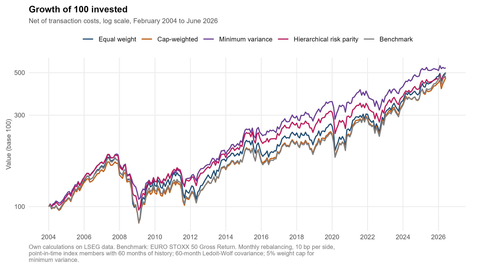
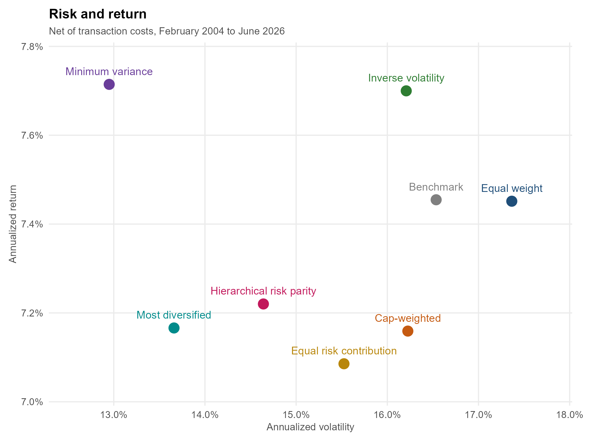

# Risk-Based Portfolio Construction on the EURO STOXX 50

Do weighting rules that use only a covariance matrix improve on the EURO STOXX 50 itself, once transaction costs and estimation error are taken into account?

This project builds seven long-only portfolios from the index constituents, rebalanced monthly from February 2004 to June 2026, and tests them against the EURO STOXX 50 Gross Return index. There is no stock selection and no return forecast: each strategy only decides how much to hold of each eligible constituent.

| Strategy | Rule |
|---|---|
| Equal weight | 1/N across eligible stocks |
| Cap-weighted | weight proportional to market capitalisation |
| Inverse volatility | weight proportional to 1/volatility |
| Minimum variance | long-only minimum-variance portfolio, 5% cap per stock |
| Equal risk contribution | equal share of portfolio risk per stock |
| Most diversified | maximum diversification ratio, 5% cap per stock |
| Hierarchical risk parity | recursive bisection on a clustering tree (López de Prado, 2016) |

The full write-up is in [`Risk_Based_Portfolio_Construction_EuroStoxx50.pdf`](Risk_Based_Portfolio_Construction_EuroStoxx50.pdf).
## Main findings

Net of 10 bp transaction costs per side, 269 monthly returns:

| Strategy | Return | Volatility | Sharpe | Max drawdown | Avg monthly turnover |
|---|---|---|---|---|---|
| Equal weight | 7.45% | 17.36% | 0.43 | −54.59% | 2.79% |
| Cap-weighted | 7.16% | 16.22% | 0.44 | −51.88% | 1.07% |
| Inverse volatility | 7.70% | 16.21% | 0.47 | −52.98% | 2.75% |
| Minimum variance | 7.71% | 12.95% | 0.55 | −42.03% | 5.23% |
| Equal risk contribution | 7.09% | 15.52% | 0.44 | −52.44% | 3.07% |
| Most diversified | 7.17% | 13.66% | 0.49 | −44.19% | 5.81% |
| Hierarchical risk parity | 7.22% | 14.64% | 0.47 | −48.76% | 10.17% |
| EURO STOXX 50 Gross Return | 7.45% | 16.54% | 0.45 | −53.69% | – |

- **Volatility falls significantly.** Minimum variance runs at 0.78 times the benchmark's volatility (95% interval 0.73 to 0.84).
- **Return and Sharpe ratio are not shown to differ.** No mean active return is significant (p-values 0.28 to 0.85). The Sharpe difference of minimum variance against the benchmark is 0.10, with a 95% interval of −0.06 to +0.27.
- **The advantage depends on the period.** Minimum variance, most diversified and hierarchical risk parity beat the index in 2004–2019 and trailed it in 2020–2026 by about 5.3% to 5.7% a year.
- **Style.** Relative to the index, these rules hold less market beta and more profitable and conservatively investing firms. No relative alpha is significant.
- **Power is limited.** The bootstrap standard error of the minimum-variance Sharpe difference is 0.08, so differences below about 0.17 cannot be told apart from zero.

<p align="center">
  
</p>
<p align="center">
  
</p>

## Method in brief

- **Universe.** Point-in-time EURO STOXX 50 membership rebuilt from LSEG joiners-and-leavers records. Securities are keyed by PermID. A stock is a candidate on a formation date only if it is an index member and has 60 complete months of return history, which leaves 46 to 50 candidates per month.
- **Implementation.** Weights formed at the end of month t earn the return of month t+1. Monthly rebalancing, 10 bp per side on traded weight.
- **Risk estimation.** 60-month covariance. Ledoit-Wolf shrinkage for minimum variance, equal risk contribution, most diversified and hierarchical risk parity. Sample covariance for inverse volatility.
- **Benchmark and risk-free rate.** EURO STOXX 50 EUR Gross Return (RIC `.SX5GT`). Sharpe ratios use the one-month Euribor from the ECB Data Portal.
- **Factor attribution.** Fama-French Europe factors plus momentum. They are in US dollars and cover a wider region, so attribution is run on the difference between each strategy and the benchmark, not on absolute returns.
- **Inference.** Newey-West standard errors, circular block bootstrap (blocks of 6 months, 5,000 replications) for Sharpe and volatility comparisons, Holm adjustment within each family of tests. Seeds are fixed.
- **Robustness.** One element changed at a time: estimation window, covariance estimator, weight cap, rebalancing frequency, execution lag, transaction costs and HRP linkage.

## Repository structure

```
Euro_Stoxx_50_Analysis.R     main script: ten sequential sections, run from the project root
R/
  01_dati_pit.R              point-in-time membership, security key, panel, LSEG adapters
  02_segnali_backtest.R      eligibility signal, timeline, delisting, backtest engine
  03_costruttori_rischio.R   Ledoit-Wolf shrinkage and the five risk-based weighting rules
  04_valutazione.R           benchmark and factors, metrics, tests, attribution, robustness
  05_output.R                tables and figures
  06_diagnostica.R           diagnostics and final controls
tabelle/                     result tables (CSV and one Excel workbook)
grafici/                     figures (four strategies in the time-series charts)
grafici_tutte/               figures (all seven strategies)
Risk_Based_Portfolio_Construction_EuroStoxx50.pdf    full report
```

Folder names and internal identifiers are in Italian (`dati` is data, `tabelle` is tables, `grafici` is figures, `periodo` is month, `pannello` is panel). Code comments, console messages, tables, figures and the report are in English.

## Data and reproducibility

**The input data are not included.** Prices, market capitalisations, index membership and identifiers come from LSEG Workspace under a licence that does not allow redistribution, so the `dati/` folder is excluded from the repository. The tables and figures in `tabelle/`, `grafici/` and `grafici_tutte/` are aggregated results computed from those data.

To rebuild everything you need:

1. LSEG Workspace with API access and the key stored in the environment variable `LSEG_APP_KEY` (for example in `~/.Renviron`).
2. The two LSEG exports for `.STOXX50E` in `dati/`: `SX5E Leavers & Joiners Constituents.xlsx` and `SX5E Current Constituents.xlsx`.
3. Internet access for the public inputs: Fama-French Europe factors (Kenneth French's data library) and the one-month Euribor (ECB Data Portal).
4. R 4.5 and the packages below. Open R in the project root and run `Euro_Stoxx_50_Analysis.R` from top to bottom. Each data step saves its output in `dati/` and is skipped on later runs if the file exists; LSEG Workspace is needed only for the steps whose file is missing.

Packages used: `dplyr`, `tidyr`, `lubridate`, `ggplot2`, `scales`, `readxl`, `writexl`, `quadprog` and `Refinitiv`. Developed with R 4.5.2 (dplyr 1.2.1, ggplot2 4.0.3, lubridate 1.9.5, tidyr 1.3.2, quadprog 1.5.8, readxl 1.5.0, writexl 2.0.1, scales 1.4.0, Refinitiv 0.2.2).

## Limitations

- **Statistical power.** 269 monthly observations are not enough to prove a Sharpe improvement of about 0.10.
- **One narrow universe.** 46 to 50 large caps per date. Results could differ in a broader universe.
- **Factor data mismatch.** US-dollar, pan-European factors against a euro-area index. A variant with euro style indices would be cleaner.
- **Design choices.** Window, cap, rebalancing frequency and estimator are fixed in the base case and varied one at a time, not jointly. Quarterly rebalancing would have improved minimum variance.
- **Regimes.** The four subperiods were fixed in advance and follow economic episodes. They are not tested with a break test.
- **Cost model.** A flat 10 bp per side. No market impact, time-varying spreads, taxes or capacity limits.
- **Terminal returns.** Every permanent exit books 0% in its last month. Only one of the 24 permanent exits, Sanpaolo IMI in December 2006, was still an index member on the formation date of its last month.

## Author

Giovanni Ferrante, MSc in Banking and Finance
